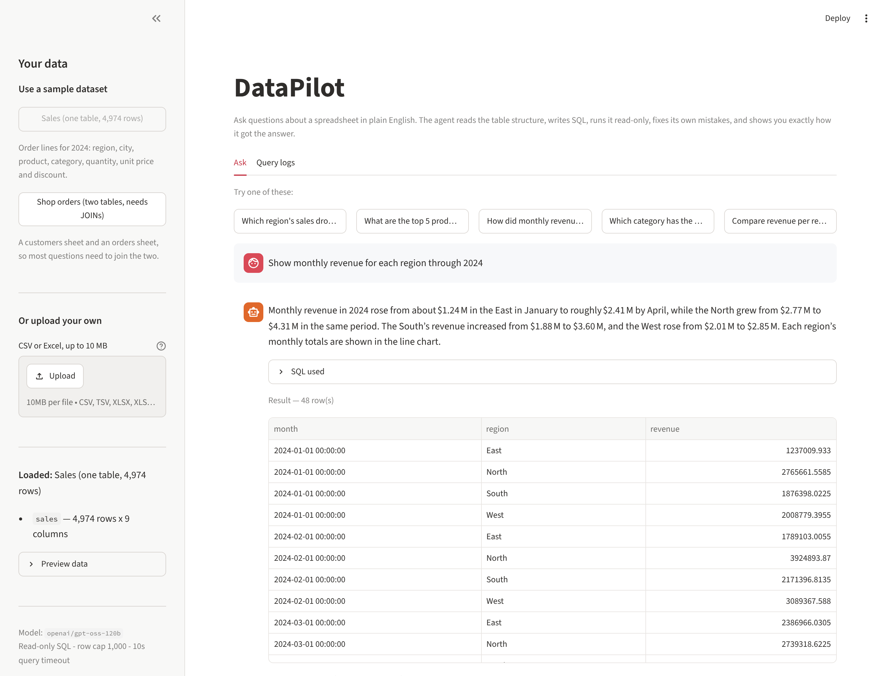
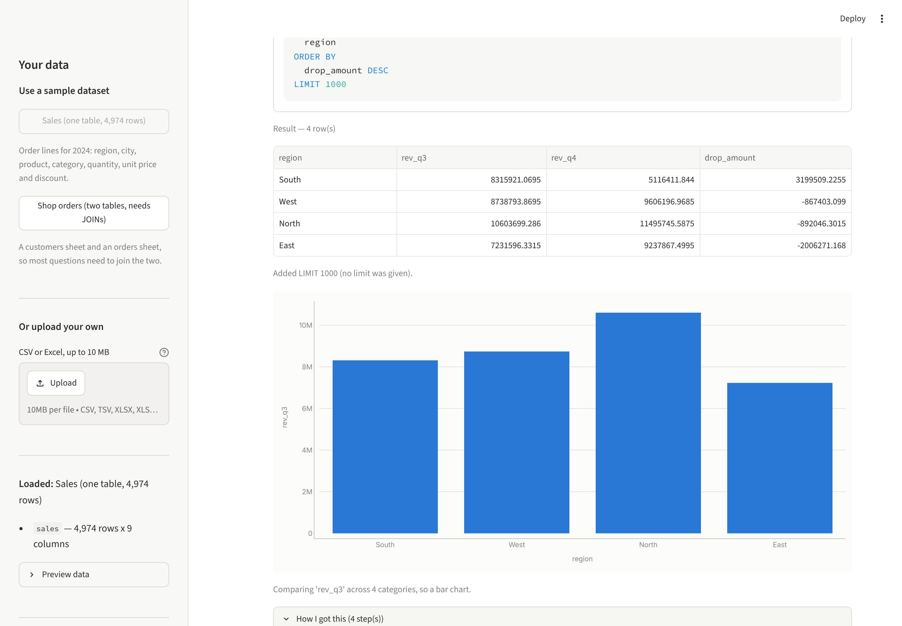
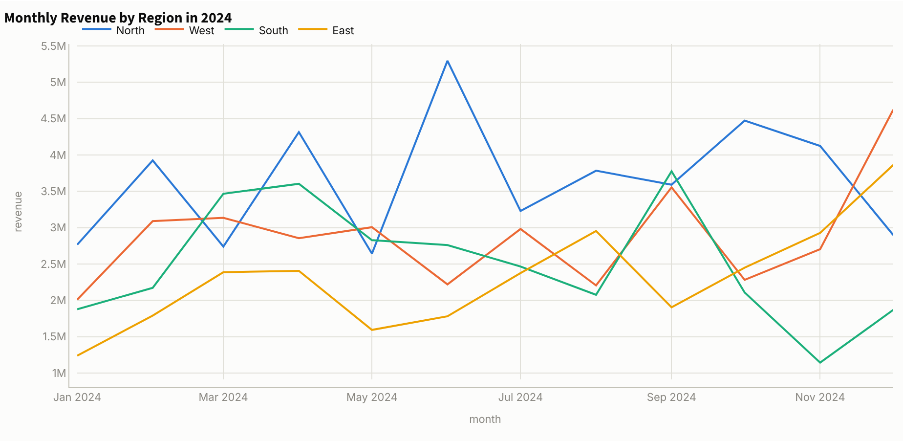
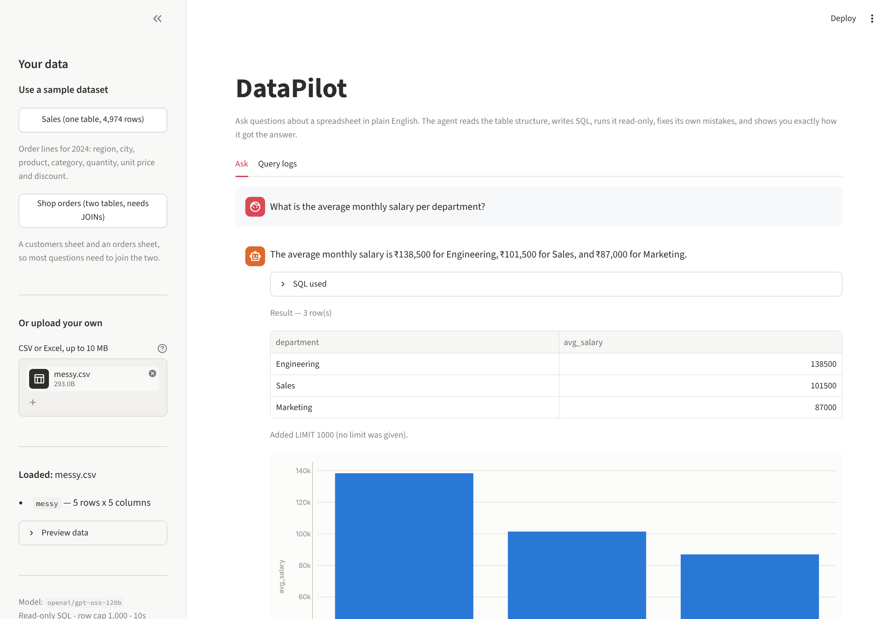
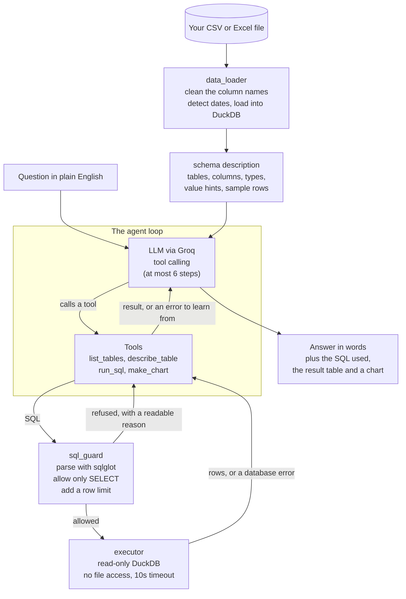
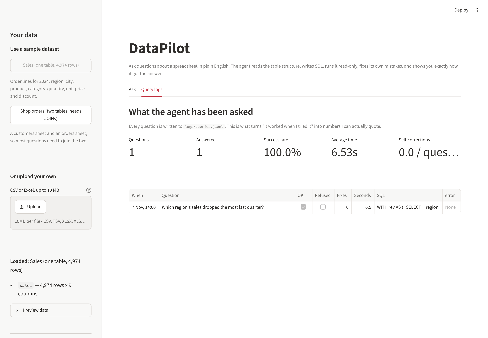

# DataPilot -- ask your data questions in plain English

Upload a spreadsheet, ask a question the way you would ask a colleague, and get
an answer **with the SQL that produced it**, the result table and a chart.

> *"Which region's sales dropped the most last quarter?"*
>
> **South's revenue fell the most, from 8.32 million in Q3 to 5.12 million in
> Q4 2024 -- a drop of 38.5%.**
>
> ...shown alongside the exact SQL, the four-row result table, and a chart.

DataPilot is an **AI agent**, not a chatbot. It is given tools, and it decides
how to use them: it inspects the table structure, writes SQL, runs it against a
read-only database, reads the error and rewrites the query when it gets one, and
only then answers. Every number it reports comes from a query you can see.



---

## Contents

- [What it does](#what-it-does)
- [Quick start](#quick-start)
- [How it works](#how-it-works)
- [Safety: three layers of defence](#safety-three-layers-of-defence)
- [Evaluation results](#evaluation-results)
- [Project layout](#project-layout)
- [Limitations](#limitations)
- [Future work](#future-work)

---

## What it does

| | |
|---|---|
| **Ask in English** | "Who are the top 3 customers by total spend?" |
| **Works on your files** | CSV, TSV or Excel. Each Excel sheet becomes a table, so questions can join across sheets. |
| **Shows its working** | Every answer carries the SQL, the result table, and a step-by-step list of what the agent did. |
| **Fixes its own mistakes** | A failed query comes back as a readable error, which the agent reads and corrects. |
| **Refuses honestly** | If the data cannot answer the question, it says so instead of inventing a number. |
| **Cannot damage your data** | Read-only by three independent mechanisms. |
| **Charts when useful** | Chart type chosen from the shape of the result, not guessed. |

### Seeing how it got there

Every answer can be unfolded: the SQL it ran, and each step it took, including
any query that failed and the error it learned from.



### Charts chosen from the result



### Your own files

Messy headers are fine -- `Monthly Salary (INR)` becomes `monthly_salary_inr`
before the agent ever sees it.



---

## Quick start

Python 3.10 or newer.

```bash
git clone https://github.com/Bharambevaish/DataPilot.git
cd DataPilot
```

```bash
python -m venv venv
source venv/bin/activate        # Windows: venv\Scripts\activate
pip install -r requirements.txt
```

Get a free API key from [console.groq.com/keys](https://console.groq.com/keys),
then:

```bash
cp .env.example .env
```

Open `.env` and put your key in it:

```
GROQ_API_KEY=gsk_your_key_here
MODEL_NAME=openai/gpt-oss-120b
```

Generate the two sample datasets, then start the app:

```bash
python scripts/make_samples.py
```

```bash
streamlit run app.py
```

It opens at <http://localhost:8501>. Pick a sample dataset in the sidebar, or
upload your own file, and ask a question.

### Without the web app

```bash
python scripts/ask.py "which region had the highest revenue?"
```

```bash
python scripts/ask.py --dataset shop_orders "how many customers never ordered?"
```

### Running the tests

```bash
python tests/test_safety.py
```

```bash
python tests/test_agent.py
```

```bash
python tests/test_app.py
```

All three need **no API key** and run in a couple of seconds:

| Suite | Checks | What it covers |
|---|---|---|
| `test_safety.py` | 30 | 6 kinds of safe query run; 18 kinds of dangerous query refused; row caps and the timeout enforced |
| `test_agent.py` | 31 | the agent loop, driven by a *scripted* fake model so self-correction, refusal, the step cap and chart binding are proven deterministically |
| `test_app.py` | 16 | the Streamlit UI headless: demo-mode banner, uploads disabled, the question cap (including off-by-one), the empty state |

Add `--live` to `test_agent.py` to also ask the real model five questions,
including one needing a JOIN and one the data cannot answer.

### Deploying

The app runs on [Streamlit Community Cloud](https://share.streamlit.io). Point
it at `app.py`, and add this under *Settings -> Secrets*:

```toml
GROQ_API_KEY = "gsk_your_key_here"
MODEL_NAME = "openai/gpt-oss-120b"
DEMO_MODE = "true"
MAX_QUESTIONS_PER_SESSION = "20"
```

`DEMO_MODE = "true"` turns off file uploads, serves only the bundled sample
data, caps questions per visit, and shows a banner asking people not to upload
private data.

---

## How it works



The loop is the whole idea. The model is never handed the data; it is handed a
list of tools and has to ask. Each tool returns **text** -- including failures,
which come back as `ERROR: Referenced column "revenue" not found`. That is what
lets the agent repair its own query on the next turn, without any recovery code
being written for it.

Three prompt rules do most of the work for accuracy:

1. Use only the listed tables and columns, spelled exactly as given.
2. Every number in the answer must come from a query result in this
   conversation -- no estimating, no remembering.
3. Read "last quarter" against the newest date **in the data**, not today's
   real date.

Rule 2 is also enforced in code: if the model produces an answer without ever
running a query, the answer is thrown away and the user is told, rather than
shown a number that came from nowhere.

---

## Safety: three layers of defence

The agent writes SQL, and an LLM writing SQL against your data is exactly the
situation where "it'll probably be fine" is not good enough. There are three
independent mechanisms, and any one of them would block most attacks.

### Layer 1 -- parse the SQL and allowlist it (`src/sql_guard.py`)

The query is parsed with `sqlglot` into a syntax tree, and the whole statement
must be a query (`SELECT`, `WITH ... SELECT`, or a `UNION` of those).

This is an **allowlist, not a blocklist**. Scanning the text for the word
`DROP` is easy to defeat and can never cover a statement type you did not
think of. Requiring the parsed statement to *be* a SELECT refuses everything
else automatically -- `INSERT`, `UPDATE`, `DELETE`, `DROP`, `CREATE`, `ALTER`,
`ATTACH`, `COPY`, `PRAGMA`, `SET`, `INSTALL` and anything added to DuckDB in
future.

It also rejects multiple statements (so `SELECT 1; DROP TABLE x` fails), blocks
file- and network-reading functions by name and by prefix (`read_*`, `write_*`,
`glob`, ...), verifies every table named exists, and adds a row limit.

### Layer 2 -- the connection physically cannot write (`src/executor.py`)

DuckDB is opened with:

```python
duckdb.connect(path, read_only=True, config={"enable_external_access": False})
```

`read_only=True` makes the engine refuse every statement that changes data.
`enable_external_access=False` makes it refuse all filesystem and network
access, which blocks `COPY ... TO '/tmp/leak.csv'`,
`read_csv_auto('/etc/passwd')`, `ATTACH` and `INSTALL`.

This layer was tested **with the parser bypassed**, and refuses all of them on
its own. So a bug in layer 1 is not enough to lose data.

### Layer 3 -- nothing can run away

Every query gets a row limit (default 1,000, and an over-large `LIMIT` is
lowered rather than honoured) and a wall-clock timeout (default 10 seconds)
enforced with DuckDB's `interrupt()`.

### Verified, not assumed

`tests/test_safety.py` runs 30 checks: 6 kinds of safe query work, **18 kinds
of dangerous query are refused with a readable reason**, and the limits and
timeout are shown working on real data.

```
  PASS  two statements at once (SQL injection style): refused -> Only one statement is allowed...
  PASS  read a file from the machine: refused -> The function read_csv_auto() is not allowed...
  PASS  write results out to a file: refused -> COPY is not allowed. DataPilot is read-only...
  PASS  a runaway query is stopped after ~2.0s
```

---

## Evaluation results

"It worked when I tried it" is not evidence, so there is a benchmark:
**30 questions with hand-written gold SQL** (`eval/questions.json`) -- 10 easy,
10 medium, 7 hard (JOINs, percentage change, multi-step) and 3 that the data
**cannot** answer.

```bash
python eval/evaluate.py --label myrun
```

### Why results are compared, not SQL text

Comparing generated SQL to reference SQL as strings is a bad measure, because
many different queries produce the same correct answer. So both queries are
**run**, and the results compared, ignoring row order, column names and
floating-point noise. That is *execution accuracy*, the standard measure in the
text-to-SQL literature.

Two scores are reported, because they answer different questions:

- **Execution accuracy** -- the agent's result table matches the gold table.
- **Answer accuracy** -- the agent's *sentence* states the gold figure.

The gap is real: asked "which region fell the most", the agent often returns
all four regions and says "South" in the sentence. Strict execution accuracy
calls that a miss; the person reading the app got the right answer. Reporting
only the flattering number would be dishonest.

### Before and after

| | v1 baseline | v2 improved |
|---|---|---|
| **Overall accuracy** | **96.7%** (29/30) | **100%** (30/30) |
| Easy (10) | 100% | 100% |
| Medium (10) | 100% | 100% |
| Hard (7) | 85.7% | **100%** |
| Unanswerable refused (3) | 100% | 100% |
| Execution accuracy (strict) | 96.3% | 92.6% |
| Answer accuracy | 88.9% | **100%** |
| Average time per question | 22.4s | 24.1s |

The full write-up, including what each failure was and what was changed, is in
**[eval/results.md](eval/results.md)**.

The headline finding is worth repeating: the single v1 failure turned out to be
**a bug in the measurement, not in the agent**. The model wrote "Cotton T‑Shirt"
with a Unicode non-breaking hyphen; the gold answer used an ASCII one, so a
correct answer was scored wrong. When a metric says your system failed, check
the metric too.



---

## Project layout

```
DataPilot/
├── app.py                   Streamlit UI (interface only - no SQL, no prompts)
├── src/
│   ├── config.py            settings: st.secrets -> env vars -> .env
│   ├── data_loader.py       CSV/XLSX -> DuckDB tables, clean column names, detect dates
│   ├── schema.py            the text description of the data that the LLM reads
│   ├── sql_guard.py         safety layer 1: parse the SQL, allow only SELECT
│   ├── executor.py          safety layers 2 and 3: read-only DuckDB, limits, timeout
│   ├── tools.py             the four tools the agent may call, with JSON schemas
│   ├── agent.py             the agent loop and the system prompt
│   ├── charts.py            picks a chart type from the shape of the result
│   └── logger.py            one JSON line per question, for the logs tab
├── scripts/
│   ├── make_samples.py      generates the two sample datasets (fixed seed)
│   └── ask.py               ask a question from the command line
├── eval/
│   ├── questions.json       30 questions with gold SQL
│   ├── evaluate.py          execution accuracy + answer accuracy
│   └── results.md           the full evaluation write-up
├── tests/
│   ├── test_safety.py       30 checks on the safety layers
│   ├── test_agent.py        31 checks on the agent loop, using a scripted fake model
│   └── test_app.py          16 checks on the UI, headless, no API key needed
└── docs/
    └── interview-notes.md   my own notes on every design decision
```

### The sample data

`python scripts/make_samples.py` generates both datasets from a fixed random
seed, so they are identical on every machine -- which is what lets the
evaluation store expected answers.

- **`sales.csv`** -- 4,974 order lines for 2024: region, city, product,
  category, quantity, unit price, discount. Weekends are busier, November and
  December peak, and the South region deliberately loses about 38% of its
  revenue in Q4, so the demo question has a real, checkable answer.
- **`shop_orders.xlsx`** -- a `customers` sheet and an `orders` sheet, so most
  questions need a JOIN. 32 customers have never ordered, which makes
  `LEFT JOIN` questions meaningful.

---

## Limitations

Worth being straight about these.

- **Accuracy depends on the model.** 100% is on *these* 30 questions against
  *this* synthetic data with `openai/gpt-oss-120b`. It is enough to catch
  regressions, not a general accuracy claim.
- **Real data is messier.** Inconsistent category spellings, nulls everywhere
  and five date formats in one column are harder than anything here.
- **No follow-up questions.** Each question starts a fresh conversation, so
  "and what about the North?" will not work. That is a deliberate trade-off:
  no cross-question contamination, but no memory either.
- **Files are read into memory**, hence the 10 MB upload cap.
- **Value hints do not scale.** Listing every distinct value works for 12
  cities, not for 50,000 customer names.
- **Each question costs an API call or several** -- about 2 model turns on
  average, and 20-25 seconds.

## Future work

1. Follow-up questions, by keeping the last result in context.
2. Few-shot examples in the prompt -- the most common text-to-SQL accuracy win.
3. Show confidence: flag answers that needed several self-corrections.
4. A bigger, deliberately ambiguous evaluation set, where asking a clarifying
   question is the right behaviour.
5. Connect to a read-only PostgreSQL user instead of only files.
6. A `POST /ask` FastAPI endpoint so other apps can use the agent.

---

## Built with

Python · [DuckDB](https://duckdb.org) · [sqlglot](https://github.com/tobymao/sqlglot) ·
[Groq](https://groq.com) tool calling · [Streamlit](https://streamlit.io) ·
[Plotly](https://plotly.com/python/) · pandas
